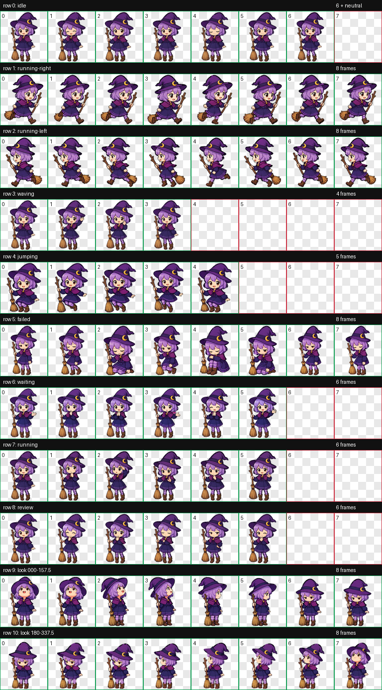
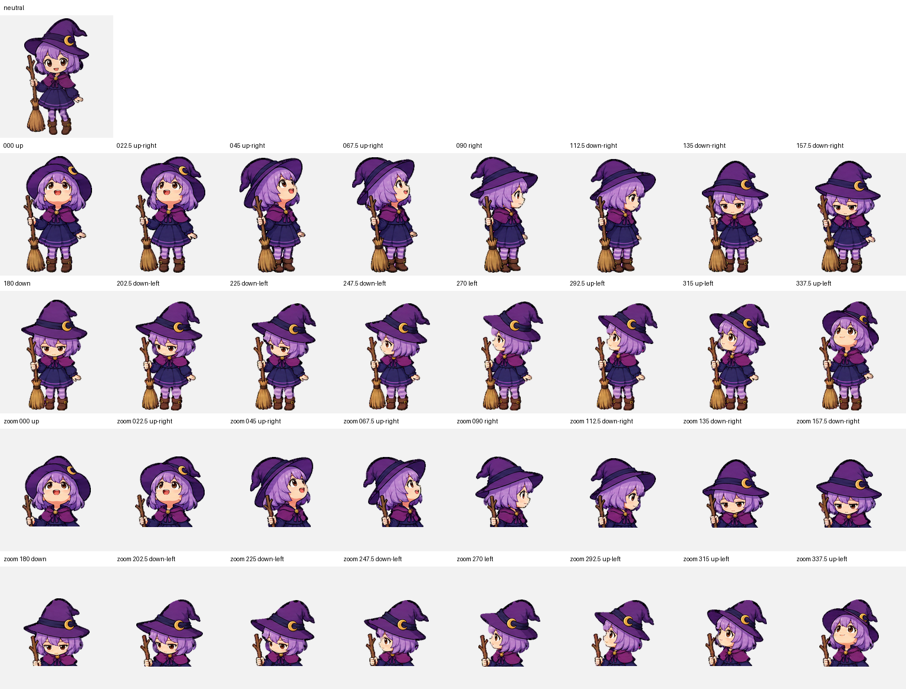

# Codi — Codex Animated Pet

<p align="center">
  
</p>

Codi is a cheerful chibi little witch with lavender bob hair, a floppy violet hat with a gold crescent, a plum capelet over a midnight-indigo dress, striped lavender stockings, and a tiny twig broom held in her right hand. Her compact silhouette, warm expression, and clean dark-purple outlines stay readable at pet size. She is packaged as a Codex sprite v2 pet with nine standard animation states and sixteen clockwise look directions.

코디는 라벤더색 단발머리와 금색 초승달 장식이 달린 보랏빛 마녀 모자, 자두색 케이프와 남색 드레스, 줄무늬 라벤더 스타킹, 오른손에 든 작은 나뭇가지 빗자루가 특징인 밝고 친근한 꼬마마녀 치비 캐릭터입니다. 따뜻한 표정과 짙은 보랏빛 외곽선, 단단한 실루엣을 사용해 작은 펫 크기에서도 또렷하게 보입니다. Codex sprite v2 규격의 아홉 가지 기본 애니메이션과 열여섯 방향 시선을 지원합니다.

## Highlights

- Codex sprite contract: v2
- Atlas: `1536 × 2288` WebP with transparency
- Cell size: `192 × 208`
- Layout: 8 columns × 11 rows
- Standard states: idle, drag right, drag left, wave, jump, failed, waiting, working, review
- Look loop: 16 directions in 22.5-degree steps
- Public QA: atlas validation, three-reviewer blind direction validation, and independent final visual QA

## Animation previews

| Idle | Drag right | Drag left |
| --- | --- | --- |
|  |  |  |

| Wave | Jump | Failed |
| --- | --- | --- |
|  |  |  |

| Waiting for input | Working | Review |
| --- | --- | --- |
|  |  |  |

## Full sprite and look-direction previews

<details>
<summary>Open the complete 8 × 11 animation sheet</summary>



</details>

<details>
<summary>Open the neutral + 16-direction QA sheet</summary>



</details>

## Install

From the repository root on macOS or Linux:

```bash
mkdir -p "$HOME/.codex/pets/codi"
cp "Codi/pet.json" "$HOME/.codex/pets/codi/pet.json"
cp "Codi/spritesheet.webp" "$HOME/.codex/pets/codi/spritesheet.webp"
```

Restart or refresh the Codex desktop app if Codi does not appear immediately.

To uninstall:

```bash
rm -rf "$HOME/.codex/pets/codi"
```

## Required package files

Only these files are required by Codex:

```text
Codi/
├── pet.json
└── spritesheet.webp
```

The `previews`, `screenshots`, and `qa` folders are documentation and verification artifacts for repository visitors.

## Verification

The published package passed the following checks:

- `spriteVersionNumber: 2`
- WebP RGBA, `1536 × 2288`
- 8 columns × 11 rows
- Transparent RGB residue: 0 pixels
- Atlas errors and warnings: none
- Both cardinal blind-direction pairs passed. Four intermediate horizontal readings were accepted as reviewed minor warnings after the labeled loop confirmed the intended quadrants and continuity.
- All sixteen labeled look directions passed independent final visual review, with reviewed minor lateral-cue warnings at `135`, `157.5`, `202.5`, and `225` degrees.
- Continuity metric warnings were accepted after the ordered loop showed no visible normal-size snap, clipping, scale pop, identity break, or broom detachment.
- Published package and key screenshot checksums are listed in [`SHA256SUMS`](SHA256SUMS)

See [`qa/validation.json`](qa/validation.json), [`qa/direction-blind-validation.json`](qa/direction-blind-validation.json), and [`qa/final-visual-qa.json`](qa/final-visual-qa.json) for the public QA summaries.

## License

The package uses two licenses:

- `pet.json`, this README, `SHA256SUMS`, and files in `qa/` are available under the [MIT License](../LICENSES/MIT.txt).
- `spritesheet.webp`, images in `screenshots/`, and animations in `previews/` are available under [CC BY 4.0](../LICENSES/CC-BY-4.0.md).

When sharing or adapting Codi's visual assets, use this attribution where practical:

> Codi Codex Pet by Ryu JaeHyun, licensed under CC BY 4.0.

See the repository's [license overview](../LICENSE.md) for details.
