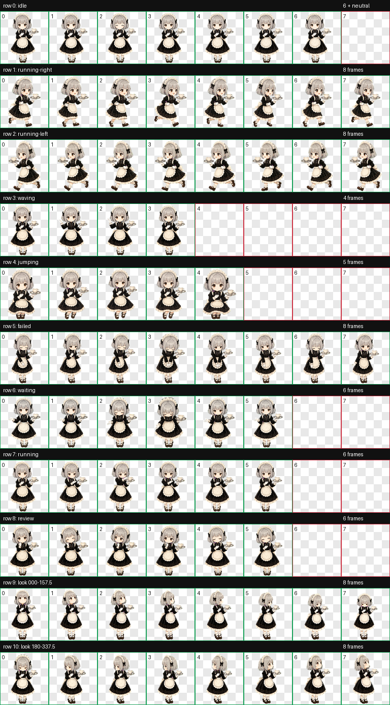
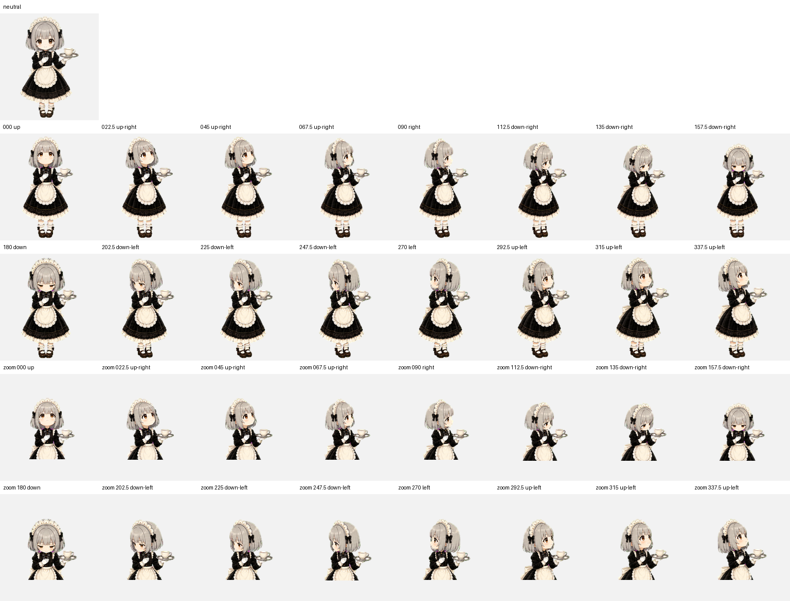

# Pina — Codex Animated Pet

<p align="center">
  
</p>

Pina is a courteous gothic-lolita chibi maid with a neat pearl-gray bob, warm brown eyes, a scalloped ivory lace headband, and a high-neck black velvet dress with puff sleeves and black lace trim. Her antique-ivory ruffled apron, white gloves, dark brown Mary Janes, and small polished-silver tea tray with an ivory cup keep her refined maid silhouette readable at pet size. She is packaged as a Codex sprite v2 pet with nine standard animation states and sixteen clockwise look directions.

피나는 진주빛 회색 단발과 따뜻한 갈색 눈, 아이보리 레이스 머리띠, 퍼프소매와 검정 레이스 장식이 있는 검정 벨벳 고딕 로리타 메이드복이 특징인 공손한 치비 메이드입니다. 앤티크 아이보리 프릴 앞치마, 흰 장갑, 짙은 갈색 메리제인 슈즈, 아이보리 찻잔을 올린 작은 은색 티 트레이로 작은 펫 크기에서도 단정하고 우아한 메이드 실루엣이 또렷하게 보입니다. Codex sprite v2 규격의 아홉 가지 기본 애니메이션과 열여섯 방향 시선을 지원합니다.

## Highlights

- Codex sprite contract: v2
- Atlas: `1536 × 2288` WebP with transparency
- Cell size: `192 × 208`
- Layout: 8 columns × 11 rows
- Standard states: idle, drag right, drag left, wave, jump, failed, waiting, working, review
- Look loop: 16 directions in 22.5-degree steps
- Public QA: atlas validation, three-reviewer blind direction validation, and independent final visual QA

## Animation previews

| Idle | Drag right | Drag left |
| --- | --- | --- |
|  |  |  |

| Wave | Jump | Failed |
| --- | --- | --- |
|  |  |  |

| Waiting for input | Working | Review |
| --- | --- | --- |
|  |  |  |

## Full sprite and look-direction previews

<details>
<summary>Open the complete 8 × 11 animation sheet</summary>



</details>

<details>
<summary>Open the neutral + 16-direction QA sheet</summary>



</details>

## Install

From the repository root on macOS or Linux:

```bash
mkdir -p "$HOME/.codex/pets/pina"
cp "Pina/pet.json" "$HOME/.codex/pets/pina/pet.json"
cp "Pina/spritesheet.webp" "$HOME/.codex/pets/pina/spritesheet.webp"
```

Restart or refresh the Codex desktop app if Pina does not appear immediately.

To uninstall:

```bash
rm -rf "$HOME/.codex/pets/pina"
```

## Required package files

Only these files are required by Codex:

```text
Pina/
├── pet.json
└── spritesheet.webp
```

The `previews`, `screenshots`, and `qa` folders are documentation and verification artifacts for repository visitors.

## Verification

The published package passed the following checks:

- `spriteVersionNumber: 2`
- WebP RGBA, `1536 × 2288`
- 8 columns × 11 rows
- Transparent RGB residue: 0 pixels
- Atlas errors and warnings: none
- Both cardinal blind-direction pairs passed. Five intermediate horizontal pair groups had weak or reversed blind readings, documented as reviewed warnings after the labeled semantic loop confirmed all intended quadrants and continuity.
- All sixteen labeled look directions passed independent final visual review.
- Continuity metric warnings at `157.5 → 180` and `270 → 292.5` were accepted after the ordered loop showed no visible normal-size snap, clipping, scale pop, identity break, or tea-tray/cup detachment.
- Published package and key screenshot checksums are listed in [`SHA256SUMS`](SHA256SUMS)

See [`qa/validation.json`](qa/validation.json), [`qa/direction-blind-validation.json`](qa/direction-blind-validation.json), and [`qa/final-visual-qa.json`](qa/final-visual-qa.json) for the public QA summaries.

## License

The package uses two licenses:

- `pet.json`, this README, `SHA256SUMS`, and files in `qa/` are available under the [MIT License](../LICENSES/MIT.txt).
- `spritesheet.webp`, images in `screenshots/`, and animations in `previews/` are available under [CC BY 4.0](../LICENSES/CC-BY-4.0.md).

When sharing or adapting Pina's visual assets, use this attribution where practical:

> Pina Codex Pet by Ryu JaeHyun, licensed under CC BY 4.0.

See the repository's [license overview](../LICENSE.md) for details.
