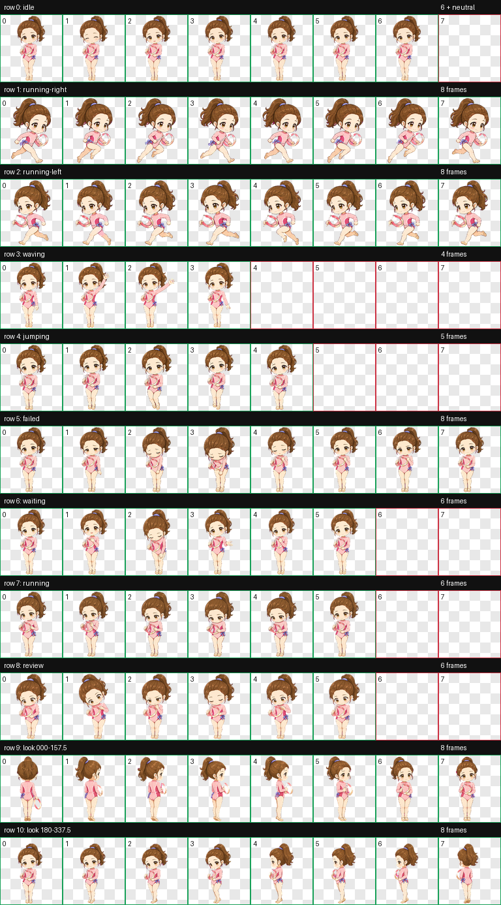
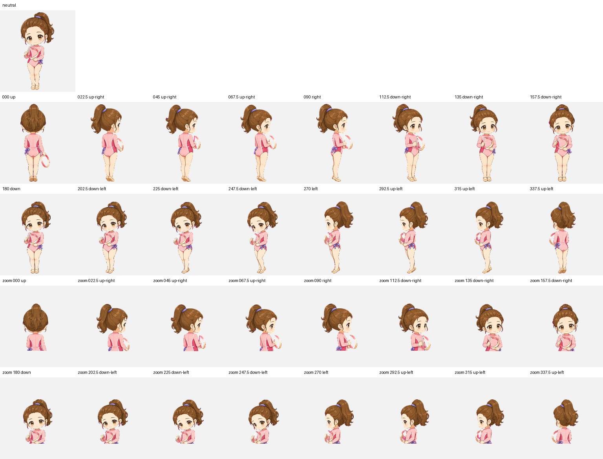

# Sori — Codex Animated Pet

<p align="center">
  
</p>

Sori is a shy, delicate chibi rhythmic gymnast with a very fair ivory-peach complexion, bright hazel eyes, and a chestnut high ponytail tied with a periwinkle elastic. Her blush-pink and berry-pink long-sleeve leotard has ivory piping and a small periwinkle waist tie. Beige half-shoes, a short white ribbon wand, and one compact blush-pink-and-ivory ribbon loop attached to her right hand preserve a graceful, slightly fragile silhouette at pet size. She is packaged as a Codex sprite v2 pet with nine standard animation states and sixteen clockwise look directions.

소리는 매우 밝은 아이보리-피치 톤 피부와 맑은 헤이즐 눈, 페리윙클 머리끈으로 묶은 밤색 하이 포니테일이 특징인 수줍고 여린 치비 리듬체조 선수입니다. 아이보리 파이핑과 작은 페리윙클 허리 리본이 들어간 연분홍·베리핑크 긴소매 레오타드, 베이지 하프슈즈, 짧은 흰색 리본 완드와 오른손에 연결된 작고 단정한 연분홍·아이보리 리본 루프로 작은 펫 크기에서도 우아하고 섬세한 실루엣이 또렷하게 보입니다. Codex sprite v2 규격의 아홉 가지 기본 애니메이션과 열여섯 방향 시선을 지원합니다.

## Highlights

- Codex sprite contract: v2
- Atlas: `1536 × 2288` WebP with transparency
- Cell size: `192 × 208`
- Layout: 8 columns × 11 rows
- Standard states: idle, drag right, drag left, wave, jump, failed, waiting, working, review
- Look loop: 16 directions in 22.5-degree steps
- Public QA: atlas validation, three-reviewer blind direction validation, and independent final visual QA

## Animation previews

| Idle | Drag right | Drag left |
| --- | --- | --- |
|  |  |  |

| Wave | Jump | Failed |
| --- | --- | --- |
|  |  |  |

| Waiting for input | Working | Review |
| --- | --- | --- |
|  |  |  |

## Full sprite and look-direction previews

<details>
<summary>Open the complete 8 × 11 animation sheet</summary>



</details>

<details>
<summary>Open the neutral + 16-direction QA sheet</summary>



</details>

## Install

From the repository root on macOS or Linux:

```bash
mkdir -p "$HOME/.codex/pets/sori"
cp "Sori/pet.json" "$HOME/.codex/pets/sori/pet.json"
cp "Sori/spritesheet.webp" "$HOME/.codex/pets/sori/spritesheet.webp"
```

Restart or refresh the Codex desktop app if Sori does not appear immediately.

To uninstall:

```bash
rm -rf "$HOME/.codex/pets/sori"
```

## Required package files

Only these files are required by Codex:

```text
Sori/
├── pet.json
└── spritesheet.webp
```

The `previews`, `screenshots`, and `qa` folders are documentation and verification artifacts for repository visitors.

## Verification

The published package passed the following checks:

- `spriteVersionNumber: 2`
- WebP RGBA, `1536 × 2288`
- 8 columns × 11 rows
- Transparent RGB residue: 0 pixels
- Atlas errors and warnings: none
- Both cardinal blind-direction pairs passed. Intermediate horizontal and vertical cues with weak blind readings are documented as reviewed warnings after the labeled semantic loop confirmed the intended quadrants and continuity.
- The labeled review has no failed direction verdicts, and the independent final visual QA passed with no blockers.
- Continuity metric warnings at `000 → 022.5`, `157.5 → 180`, `247.5 → 270`, and `337.5 → 000` were accepted after the normal-size loop showed no visible snap, clipping, scale pop, identity break, or ribbon-wand detachment.
- Published package and key screenshot checksums are listed in [`SHA256SUMS`](SHA256SUMS)

See [`qa/validation.json`](qa/validation.json), [`qa/direction-blind-validation.json`](qa/direction-blind-validation.json), and [`qa/final-visual-qa.json`](qa/final-visual-qa.json) for the public QA summaries.

## License

The package uses two licenses:

- `pet.json`, this README, `SHA256SUMS`, and files in `qa/` are available under the [MIT License](../LICENSES/MIT.txt).
- `spritesheet.webp`, images in `screenshots/`, and animations in `previews/` are available under [CC BY 4.0](../LICENSES/CC-BY-4.0.md).

When sharing or adapting Sori's visual assets, use this attribution where practical:

> Sori Codex Pet by Ryu JaeHyun, licensed under CC BY 4.0.

See the repository's [license overview](../LICENSE.md) for details.
